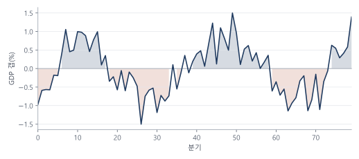

이 페이지는 메뉴에 걸지 않은 서식 견본이다. 새 페이지를 쓸 때 이 파일(`guide/showcase.qmd`)의
원문을 그대로 베껴 쓰면 된다.

## 수식

본문 속 수식은 $y_t = \tau_t + c_t$ 처럼 쓴다. 따로 세운 식에는 번호를 달고 본문에서
참조할 수 있다. Hodrick–Prescott 필터는 다음 문제를 푼다(@eq-hp).

$$
\min_{\{\tau_t\}} \; \sum_{t=1}^{T} (y_t - \tau_t)^2
  + \lambda \sum_{t=2}^{T-1} \big[(\tau_{t+1}-\tau_t) - (\tau_t - \tau_{t-1})\big]^2
$$ {#eq-hp}

Laubach–Williams 형 중립금리 모형의 핵심 식은 다음과 같다.

$$
\begin{aligned}
\tilde y_t &= a_1 \tilde y_{t-1} + a_2 \tilde y_{t-2}
  + \frac{a_r}{2} \sum_{j=1}^{2} \big(r_{t-j} - r^*_{t-j}\big) + \varepsilon^{\tilde y}_t, \\
r^*_t &= c\, g_t + z_t .
\end{aligned}
$$ {#eq-lw}

## 파이썬 코드

```python
import numpy as np

def hp_filter(y: np.ndarray, lam: float = 1600.0) -> tuple[np.ndarray, np.ndarray]:
    """HP 필터: 추세와 순환을 돌려준다."""
    n = len(y)
    D = np.diff(np.eye(n), n=2, axis=0)
    trend = np.linalg.solve(np.eye(n) + lam * D.T @ D, y)
    return trend, y - trend
```

## 그림

{#fig-gap width="90%"}

@fig-gap 은 `scripts/make_showcase_chart.py` 로 만든 예시 그림이다. 그림은 SVG로 넣으면
확대해도 선명하다.

## 표

| 방법 | 2025 | 2026 |
|:-----|-----:|-----:|
| 예시 A | 2.0 | 2.1 |
| 예시 B | 1.9 | 2.2 |

: 예시 표(가상 수치)
